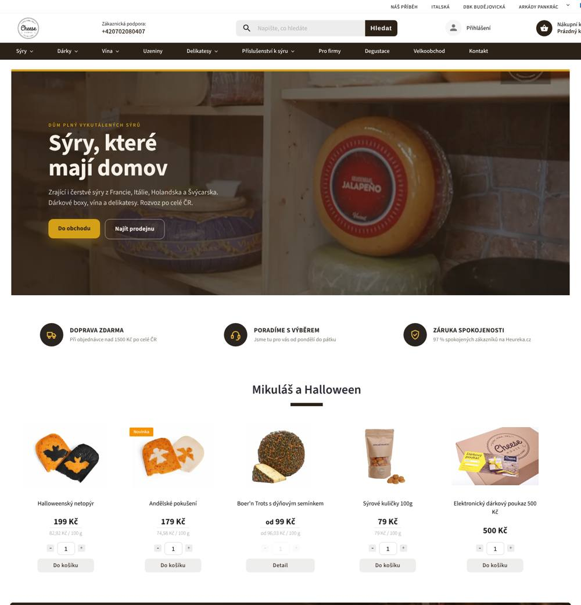
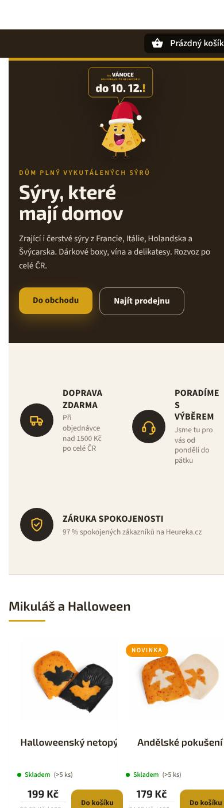

# Cheese House — cheesehouse.cz

- **Ссылка:** https://www.cheesehouse.cz/
- **Что это:** семейная сырная лавка (Прага, Пльзень) с интернет-магазином на платформе Shoptet. Импортные сыры, подарочные боксы, вино, деликатесы.
- **Дата просмотра:** 18. 11. 2026

## Структура

Сайт многостраничный, главная — витрина магазина:

1. Верхняя строка: «Náš příběh» и адреса лавок.
2. Шапка: логотип, телефон поддержки, поиск, вход, корзина.
3. Меню каталога: Sýry, Dárky, Vína, Uzeniny, Delikatesy, Příslušenství, Pro firmy, Degustace, Velkoobchod, Kontakt.
4. Hero-баннер: фото сырных голов на полке, надзаголовок «DŮM PLNÝ VYKUTÁLENÝCH SÝRŮ», заголовок «Sýry, které mají domov», две кнопки.
5. Три преимущества с иконками (доставка, совет, гарантия).
6. Сезонная подборка товаров (5 карточек с ценой и кнопкой «Do košíku»).
7. Тёмный баннер «SÝR + VÍNO — Poradíme, co k čemu» со ссылкой на дегустации.
8. Подборка подарочных боксов.
9. Отзывы покупателей.
10. Подвал: логотип, короткое «о нас», соцсети, адреса пяти лавок с часами работы.

## Визуальный стиль

| Что | Значение |
| --- | --- |
| Основной тёмный | `#2C2117` (тёмно-коричневый, почти чёрный) |
| Акцент | `#D4A017` (золотисто-жёлтый) — главная кнопка |
| Фон | белый `#FFFFFF`, серые карточки `#F6F6F6` |
| Светлый текст на тёмном | `#F7F2E9` (кремовый) |
| Шрифт | Source Sans 3 (без засечек), заголовок hero 58 px, жирный |
| Кнопки | скругление 12 px, главная — залитая золотом, вторая — контурная |

## Что берём

- **Сочетание «тёмный + золото + кремовый текст»** — это ровно палитра нашей визитки, и здесь видно, что она хорошо работает для сыра.
- **Надзаголовок капсом с разрядкой** над большим заголовком («DŮM PLNÝ VYKUTÁLENÝCH SÝRŮ» → «Sýry, které mají domov»).
- **Пара кнопок в hero:** одна залитая (главное действие), одна контурная (второе).
- **Тёмный баннер-приглашение** посреди страницы («Poradíme, co k čemu») — у нас в этой роли блок с квизом.
- **Короткие, человечные заголовки** — «Sýry, které mají domov».
- **Страница «Náš příběh»** как отдельный пункт меню.

## Что не берём

- Корзину, цены, вход, поиск, отзывы с оценками — у нас нет продажи и оплаты.
- Перегруженное меню из десяти пунктов с выпадающими списками — для сайта-презентации хватит четырёх-пяти.
- Статичные карточки товара: интерактива на сайте нет вообще, а нам он нужен.
