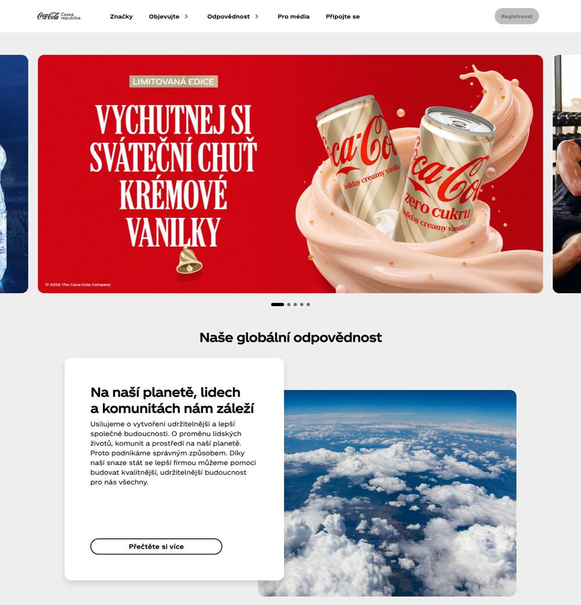
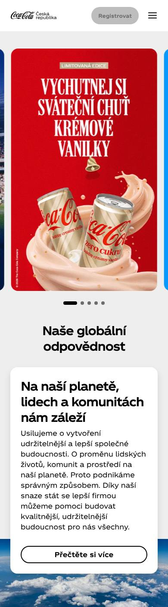

# Coca-Cola CZ — coca-cola.com/cz/cs

- **Ссылка:** https://www.coca-cola.com/cz/cs
- **Что это:** чешский сайт бренда Coca-Cola. Не магазин: сайт только показывает бренд, акции и ценности компании. Ориентир по подаче («в стиле Coca-Cola»).
- **Дата просмотра:** 18. 11. 2026

## Структура

1. Простая шапка: логотип, пять пунктов меню (Značky · Objevujte · Odpovědnost · Pro média · Připojte se), одна кнопка-«пилюля» справа.
2. Hero-карусель: огромная карточка на всю ширину со скруглёнными углами, в ней — **продукт в главной роли** (банки в завихрении крема), плашка «LIMITOVANÁ EDICE» и заголовок огромным узким капсом. По краям видны соседние слайды, под каруселью — точки.
3. Блоки «картинка + карточка с текстом», где карточка наезжает на фото; блоки чередуются слева и справа.
4. «Prozkoumejte naše značky» — сетка одинаковых квадратных плиток с логотипами брендов.
5. Тёмная полоса подписки на новости, чёрный подвал.

## Визуальный стиль

| Что | Значение |
| --- | --- |
| Фон | светло-серый `#EEEEEE`, карточки белые |
| Подвал | чёрный `#000000`, полоса над ним `#353535` |
| Цвет бренда | красный — только внутри hero и плиток, не в интерфейсе |
| Шрифт | фирменный TCCC Unity (гротеск), заголовки 32 px жирные; в баннере — узкий капс |
| Кнопки | «пилюли» с полным скруглением, контурные |
| Карточки | крупное скругление, мягкая тень |

## Что берём (принципы, а не внешний вид)

- **Продукт — главный герой первого экрана.** У нас это головка сыра из логотипа, в 3D, которую можно крутить.
- **Один экран — одна мысль:** огромный заголовок из нескольких слов и одна главная кнопка.
- **Кнопки-«пилюли»** и карточки с крупным скруглением — выглядит современно и удобно нажимать пальцем.
- **Цвет бренда дозированно:** интерфейс нейтральный, а фирменный цвет появляется в ключевых местах. У нас нейтральный — чёрный, фирменный — золото.
- **Короткое меню** из пяти пунктов.
- **Плитки одинакового размера** для ассортимента.
- **Сайт без продажи**, который всё равно «продаёт» бренд эмоцией и движением.

## Что не берём

- Фирменные шрифты, красный цвет, логотипы и изображения Coca-Cola — это чужая собственность; мы берём только принципы подачи.
- Регистрацию и подписку на рассылку — нам не нужно собирать данные посетителей.
- Светло-серый фон: у нас по визитке чёрный.
