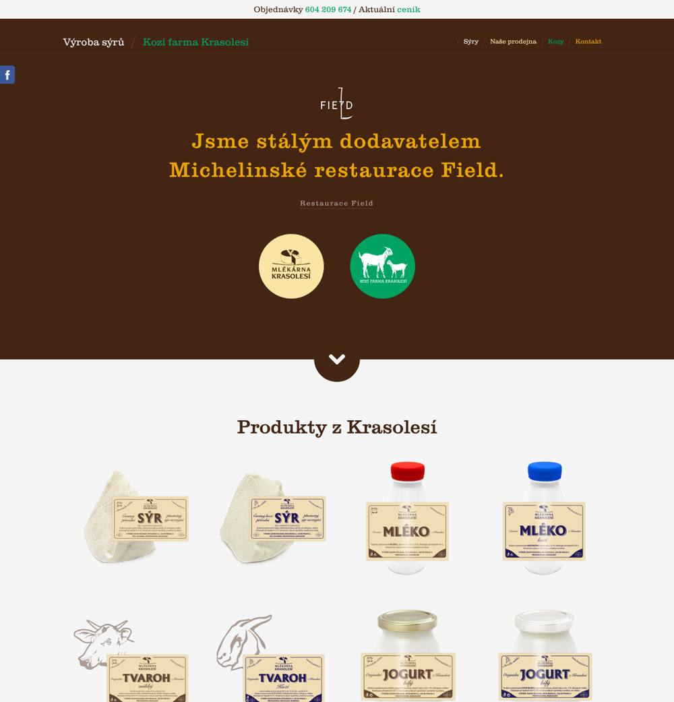
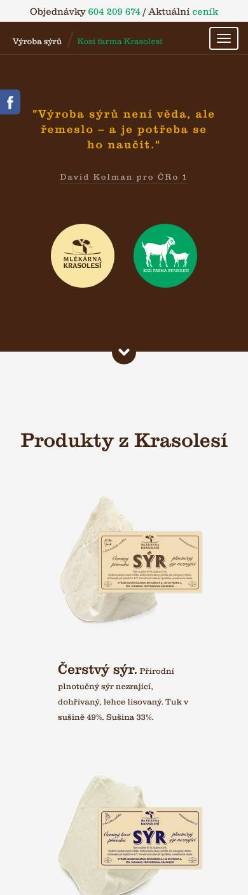

# Krasolesí — krasolesi.cz

- **Ссылка:** https://www.krasolesi.cz/
- **Что это:** сыроварня и козья ферма Krasolesí (Кошетице) с фирменной лавкой в Праге. Сайт-визитка без интернет-магазина.
- **Дата просмотра:** 18. 11. 2026

## Структура

Одна длинная страница, меню прокручивает к разделам (Sýry · Naše prodejna · Kozy · Kontakt):

1. Тонкая строка сверху: телефон для заказов и ссылка на прайс-лист (PDF).
2. Тёмно-коричневый hero: слайдер достижений («Jsme stálým dodavatelem Michelinské restaurace Field», логотипы ресторанов-партнёров) и два круглых знака — сыроварня и ферма.
3. «Produkty z Krasolesí» — сетка из 19 продуктов: вырезанные фото на светлом фоне, название написано прямо на этикетке, без цен и кнопок.
4. «Naše prodejna» — адрес и виртуальная прогулка по лавке (Google Street View, включается по клику).
5. «Kozí farma Krasolesí» — зелёный блок с рассказом о козах в две колонки.
6. «Galerie» — тёмный блок, фото с фильтром-переключателем (Vše / Mlékárna / Kozí farma / Prodej sýrů).
7. «Kontakt» — крупный телефон, почта, соцсети, часы работы, адрес производства.

Между разделами — круглая кнопка-стрелка «вниз», которая ведёт к следующему блоку.

## Визуальный стиль

| Что | Значение |
| --- | --- |
| Тёмный | `#442413` (шоколадный) |
| Акценты | `#00A362` (зелёный), `#EBA700` (жёлто-золотой), `#F9E6A4` (светло-жёлтый) |
| Фон | `#F5F5F5` |
| Шрифт | Clarendon (брусковая антиква) — и заголовки 42 px, и текст |
| Приёмы | каждый раздел — своя сплошная цветная полоса на всю ширину |

## Что берём

- **Сайт без магазина, но с ассортиментом:** продукты показаны красиво и без цен — ровно наш случай.
- **Вырезанные фото продукта на ровном фоне**, одинаковый ракурс у всех — сетка выглядит аккуратно.
- **Hero с «поводом для гордости»** (поставщик мишленовского ресторана). У нас — место под участие в ярмарке или награды.
- **Фильтр-переключатель** в галерее — простой интерактив; у нас им фильтруются сыры.
- **Интерактив «зайди к нам»** (виртуальная прогулка по лавке) — идея того же рода, что наш 3D-сыр: посетитель что-то делает сам.
- **Рассказ о происхождении** (ферма, козы, как кормят) — основа страницы «Náš příběh».
- **Один характерный шрифт на весь сайт** делает бренд узнаваемым.

## Что не берём

- Устаревшую вёрстку 2014 года: на телефоне страница растягивается до 14 000 px, часть картинок не грузится.
- Формат «всё на одной странице» — нам нужен многостраничный сайт.
- Пёструю палитру (коричневый + зелёный + серо-синий) — у нас строго чёрный и золото.
